# DAON (다온)

**English** · [한국어](README.ko.md)

**Amazon Fire HD 10 (2019)** 태블릿을 벽시계처럼 세워두는 **전체화면 상시 표시(키오스크) 대시보드**입니다. 큰 시계, 이번 달 달력, 실시간 날씨를 어두운 한 화면에 담았고, 2~3m 거리에서도 읽히도록 설계했습니다.

## 상태

**v0.6.0-dev** — TV 채널 개편: EBS 1TV·2TV를 빼고 **YTN 뉴스**·**MBC 뉴스**(유튜브 라이브, 공식 임베드)를 넣었습니다. **v0.5.0-dev** — 성능·메모리 정리(콜드 스타트 중앙값 1.77s, 달력 화면 유휴 20초 0프레임)와 달력 상단 바 `라디오`·`TV` 버튼. v0.4 에서 TV 화면을 추가했고(채널 목록·실시간 영상·전체 화면, 보는 동안 자동 전환 정지), v0.2 달력 중심 재설계는 구현 완료·실기기 검증 진행 중(T-006·T-007·T-021)입니다. v0.1 기준은 대상 기기에서 검증했습니다: Fire HD 10 (2019), Fire OS 7.3.1.2(API 28), 1920×1200 가로, 몰입형 전체화면. 제품명: **DAON(다온)**.

| 항목 | 예산 | v0.1 | v0.2-dev | v0.3-dev | v0.4-dev | v0.5-dev | v0.6-dev |
|---|---|---|---|---|---|---|---|
| 콜드 스타트 | ≤ 2.0s | 1.54s | 1.85–1.90s | 1.96s | 1.96s (중앙값) | 1.774s (중앙값) | 1.774s (중앙값) |
| 메모리(PSS) | ≤ 250MB | 65.5MB | 약 94MB (실행 중) | 약 120MB (라디오 재생 중) | 약 145MB (TV 재생 중) | 유휴 100–115MB · 라디오 97MB · TV 126MB | 유튜브 재생 중 최대 250MB · 멈춘 뒤 184MB |

## v0.6 — TV 채널: 유튜브 라이브

EBS 1TV·2TV를 빼고 **YTN 뉴스**(`aZyD6EPl6KU`)·**MBC 뉴스**(`q9bM12ucTIY`)를 KBS 1TV·2TV, MBC, SBS 옆에 넣었습니다. 여전히 6채널입니다. 유튜브는 HLS/DASH 매니페스트를 주지 않아(watch 페이지에는 `adaptiveFormats` 만 있음) ExoPlayer로는 재생할 수 없습니다. 그래서 두 채널은 **유튜브 공식 IFrame 임베드 플레이어**를 WebView(`app/src/main/assets/yt_player.html`)로 띄웁니다. 이 페이지는 `WebViewAssetLoader` 로 `https://appassets.androidplatform.net` 출처에서 내려 줍니다. `loadDataWithBaseURL` 로 띄우면 유튜브가 Referer 를 확인하지 못해 플레이어 오류 `152` 가 납니다(실측). 재생/멈춤·채널 전환·LIVE 배지·전체 화면은 다른 채널과 똑같이 동작하며, 전체 화면으로 갈 때 같은 WebView 를 옮겨 붙여 영상이 처음부터 다시 시작되지 않습니다. 재생을 멈추거나 화면을 떠나면 WebView 를 `destroy()` 하고, 오프라인·임베드 차단·25초 무응답은 기존 `다시 시도` 줄로 안내합니다.

- 메모리: 유튜브 채널을 보는 동안 PSS 약 **250MB**(예산 상한), 멈춘 뒤 약 184MB. Chromium 몫 약 100MB 는 프로세스가 내려갈 때까지 남습니다. 지상파 4채널은 기존 ExoPlayer 경로(~126MB) 그대로입니다.
- 실기기(Fire OS 7 WebView, Chromium 70) 확인: YTN·MBC 뉴스 재생, 전체 화면에서도 영상 유지, 유튜브↔HLS 채널 전환 시 안 쓰는 플레이어 반납. 테스트 65건(유튜브 파싱 2건 추가).
- 캡처: [`21-v0.6-tv-youtube-ko.png`](docs/screenshots/21-v0.6-tv-youtube-ko.png)(YTN 뉴스 재생 + 6채널 목록)

## v0.5 — 성능·메모리

시작할 때 하던 일(달력 자산·날씨·위치·기기 캘린더·저장된 일정 읽기)을 첫 프레임 뒤로 미뤄 달력이 더 빨리 뜹니다. 시계 갱신도 ViewModel 에서 빼서 `rememberNow(perSecond)` 로 옮겼습니다. 초를 보여 주는 시계 화면만 1초마다 갱신하고, 달력·날씨 화면은 분이 바뀔 때만 갱신하므로 42칸 달력을 매초 다시 그리지 않습니다. 반복 일정 펼침은 `Dispatchers.Default` 에서, 날짜 포매터는 한 번 만들어 재사용하고, 라디오와 TV 를 오갈 때 안 쓰는 플레이어는 반납합니다. 달력 상단 바에는 `라디오`·`TV` 버튼이 생겨, 두 화면을 자동 전환에서 빼 두어도 언제든 들어갈 수 있습니다(라디오 재생 중에는 `라디오` 버튼이 강조).

- 실기기 측정: 콜드 스타트 5회 1.767–1.793s(중앙값 1.774s, 이전 1.945–2.021s), 달력 화면 유휴 20초 0프레임, PSS 달력 100–115MB · 라디오 97MB · TV 126MB · 유튜브 재생 중 250MB(멈춘 뒤 184MB).
- 로그의 `budget=2000ms` 는 참고 값일 뿐이며, 넘어도 앱이 멈추거나 종료되지 않습니다.
- 캡처: [`19-v0.5-dashboard-nav-ko.png`](docs/screenshots/19-v0.5-dashboard-nav-ko.png)(상단 바 `라디오`·`TV` 버튼) · [`20-v0.5-radio-active-nav-ko.png`](docs/screenshots/20-v0.5-radio-active-nav-ko.png)(라디오 재생 중 `라디오` 버튼 강조)

## v0.4 — TV

다섯 번째 화면: 달력 → 라디오 → **TV** → 날씨 → 시계. 방송사 공식 무료 스트림 6개(KBS 1TV·2TV, MBC, SBS, EBS 1TV·2TV — v0.6 에서 EBS 두 채널을 YTN 뉴스·MBC 뉴스로 교체)를 2×3 목록으로 보여 주고, 옆에 16:9 영상 판을 둡니다. 채널을 누르면 바로 재생되고, 방송사가 짧은 토큰을 주기 때문에 재생할 때마다 주소를 새로 확인합니다(SBS 는 60초 JWT, MBC CDN 은 `Referer` 없이는 403). 영상 아래에 큰 재생/멈춤과 `전체 화면` 버튼이 있고, `전체 화면 나가기`로 목록으로 돌아옵니다.

**TV가 나오는 동안(전체 화면 포함)에는 화면 자동 전환이 멈춥니다.** 재생을 멈추거나 TV 화면을 떠나면 다시 흐릅니다. `달력` 버튼·뒤로가기·앱이 내려갈 때 재생을 멈추고, 라디오를 켜면 TV 가, TV 를 켜면 라디오가 먼저 멈춥니다. 설정의 `TV` 항목에서 화면 포함 여부·머무는 시간·기본 채널을 정합니다.

- 계획: [`docs/plans/PLAN_v0.4_tv.md`](docs/plans/PLAN_v0.4_tv.md)
- 캡처: [`16-v0.4-tv-ko.png`](docs/screenshots/16-v0.4-tv-ko.png) · [`17-v0.4-tv-playing-ko.png`](docs/screenshots/17-v0.4-tv-playing-ko.png) · [`18-v0.4-tv-fullscreen-ko.png`](docs/screenshots/18-v0.4-tv-fullscreen-ko.png)
- 재생: Media3 ExoPlayer + `media3-ui` PlayerView, H.264/AAC HLS(GMS 불필요). 플레이어는 첫 재생 때 만들어 콜드 스타트 예산을 건드리지 않습니다.
- 스트림: 방송사 공식 무료 HLS만 넣습니다. MBC 는 재생 요청에도 `Referer`/`Origin` 이 필요하고, SBS 가 주는 `http://` 주소는 기기가 평문 HTTP 를 막아 `https://` 로 올립니다.

## v0.3 — 라디오

네 번째 화면: 달력 → **라디오** → 날씨 → 시계. 방송사 공식 무료 스트림 10개(KBS·MBC·SBS·EBS·FEBC·국악방송)를 5×2 타일로 보여 주고, 위쪽 지금 방송 패널에 채널명·FM 주파수·LIVE·큰 재생/멈춤·10단계 볼륨을 담았습니다. 채널을 누르면 바로 재생되고, 방송사가 짧은 토큰을 주기 때문에 재생할 때마다 주소를 새로 확인합니다. 화면이 넘어가도 소리는 이어지고, 달력 상단의 `♪ 채널` 표시를 누르면 라디오 화면으로 돌아옵니다. 설정의 `라디오` 항목에서 화면 포함 여부·머무는 시간·기본 채널·부팅 시 자동 재생을 정합니다. 인터넷 방송이라 연결이 끊기면 `방송을 불러오지 못했습니다`와 `다시 시도` 버튼이 나옵니다.

- 목업: [`docs/mockups/v0.3-radio/index.html`](docs/mockups/v0.3-radio/index.html) · 계획: [`docs/plans/PLAN_v0.3_radio.md`](docs/plans/PLAN_v0.3_radio.md)
- 캡처: [`13-v0.3-radio-ko.png`](docs/screenshots/13-v0.3-radio-ko.png) · [`14-v0.3-radio-playing-ko.png`](docs/screenshots/14-v0.3-radio-playing-ko.png) · [`15-v0.3-radio-error-ko.png`](docs/screenshots/15-v0.3-radio-error-ko.png)
- 재생: Media3 ExoPlayer 1.5.1 + HLS(GMS 불필요). 오디오 포커스는 ExoPlayer 가 처리하고, 앱이 화면에서 내려가면 재생을 멈춥니다.
- 스트림: 방송사 공식 무료 HLS만 넣습니다. TBS FM 은 CDN 이 쓰는 GlobalSign R46 루트를 Fire OS 7 이 신뢰하지 않아 빼고 FEBC 극동방송(106.9)으로 바꿨습니다.


## v0.2 — 농사 달력 키오스크

달력 70% + 시계·날씨 30%, 음력·한국 공휴일·24절기·농사일, 달력 → 날씨 → 시계 자동 전환. 날짜를 누르면 520dp 패널에 절기·농사일·공휴일·일정을 보여 줍니다. 날씨는 현재·3시간별·7일 예보와 강수확률, 비·눈·천둥 효과를 담았습니다. 시계는 둥근 아날로그·큰 디지털·혼합 중 고를 수 있습니다.

일정은 태블릿에서 직접 추가할 수 있고, **양력/음력 날짜 기준**과 **매주·매월·매년 반복**을 고를 수 있습니다(음력 일정은 매년 같은 음력 날짜에 반복). 기기에 캘린더 provider 가 있으면 기기 일정을 읽기 전용으로 함께 표시합니다. 달력 홈의 시계·날씨 카드를 누르면 해당 화면으로 이동하고, 그 화면의 `달력` 버튼으로 대시보드에 돌아옵니다(`그 화면에서 멈추기` 모드에서도). 설정의 키오스크 항목에서 화면 고정과 부팅 자동 시작을 켤 수 있습니다.

- 상호작용 목업: [`docs/mockups/v0.2/index.html`](docs/mockups/v0.2/index.html)
- v0.2 캡처: [`docs/screenshots/04-v0.2-dashboard-ko.png`](docs/screenshots/04-v0.2-dashboard-ko.png) … `10-v0.2-settings-ko.png`
- 로컬 일정: SharedPreferences JSON, 매주·매월·매년 반복과 음력 날짜 기준. 기기 캘린더: `READ_CALENDAR`, 오늘 ±12개월. Fire OS 7 에도 캘린더 provider 가 있어 권한을 허용하면 표시된다(계정이 없으면 0건).
- 키오스크: Android 화면 고정. Device Owner 등록은 선택(`adb shell dpm set-device-owner com.borasarang.daon/.admin.AdminReceiver`).

## 스크린샷

| v0.2 달력 | 날짜 상세 | 날씨 | 시계 | 설정 |
|---|---|---|---|---|
| 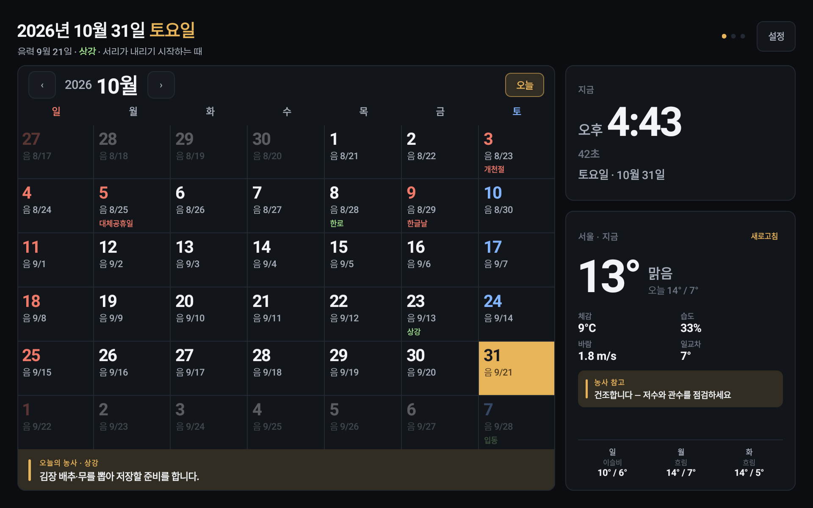 | 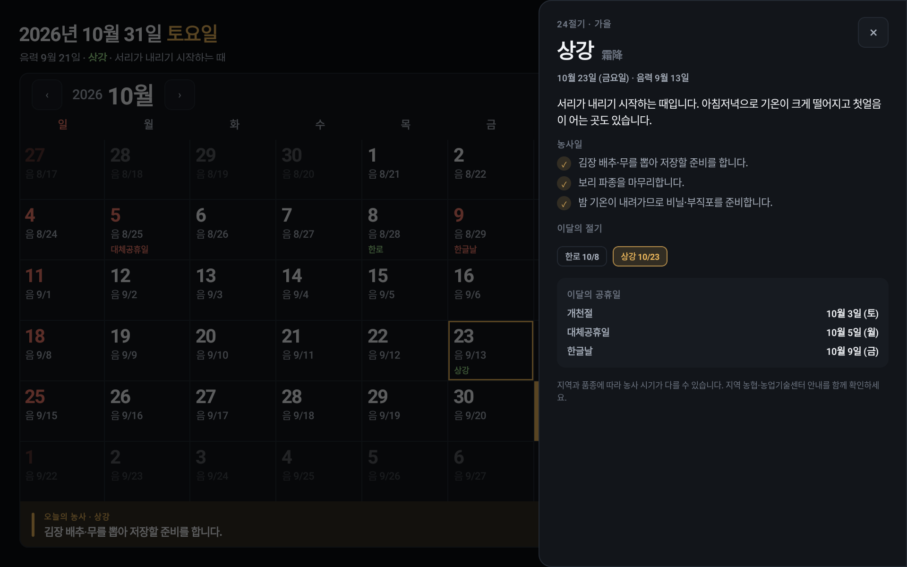 | 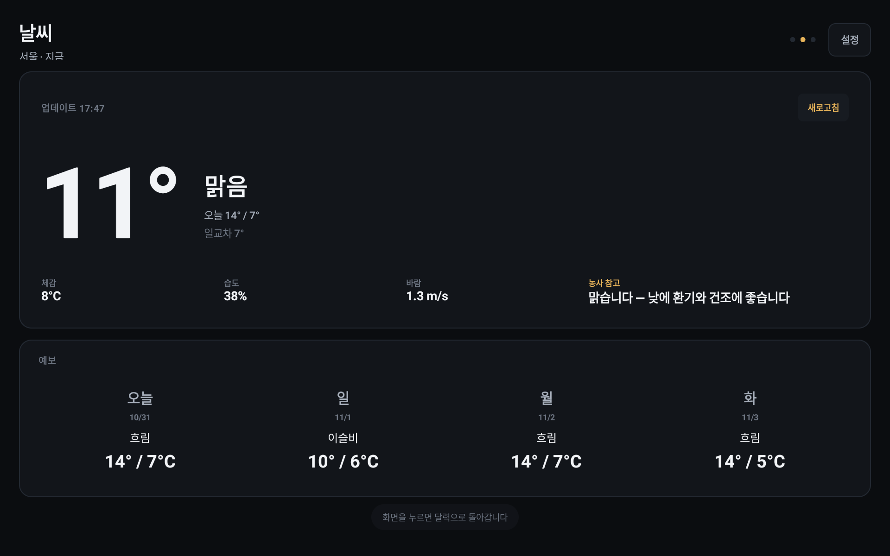 | 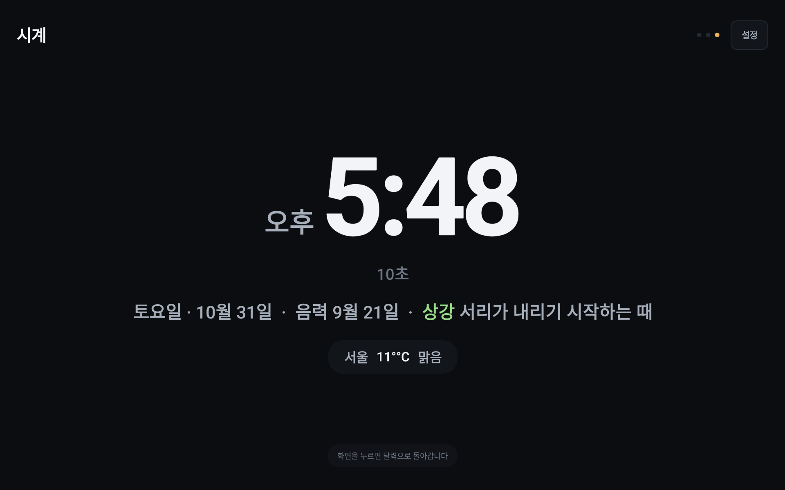 | 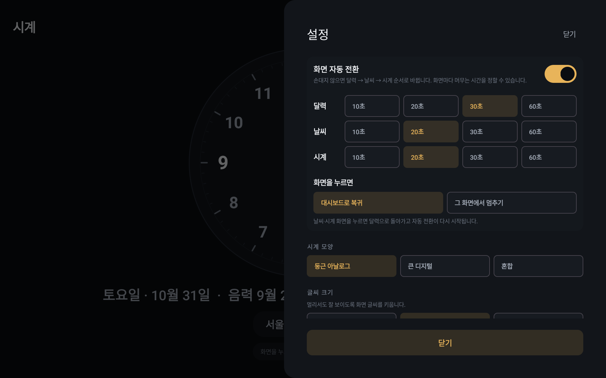 |

v0.1: 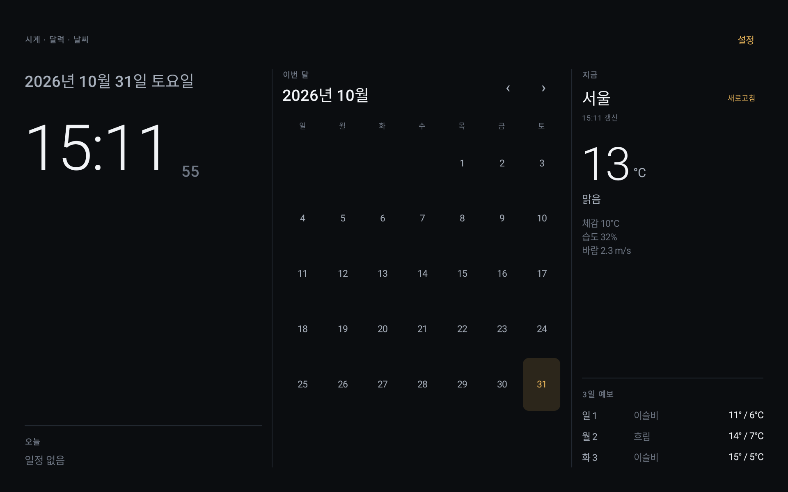 · 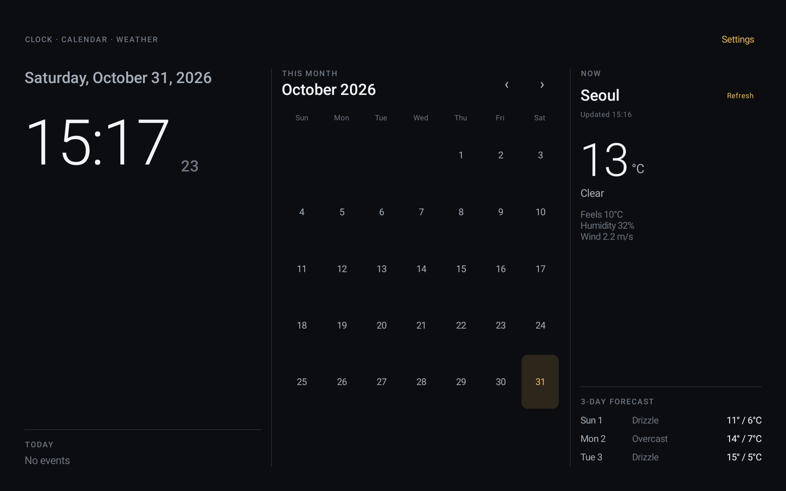

v0.3 라디오: 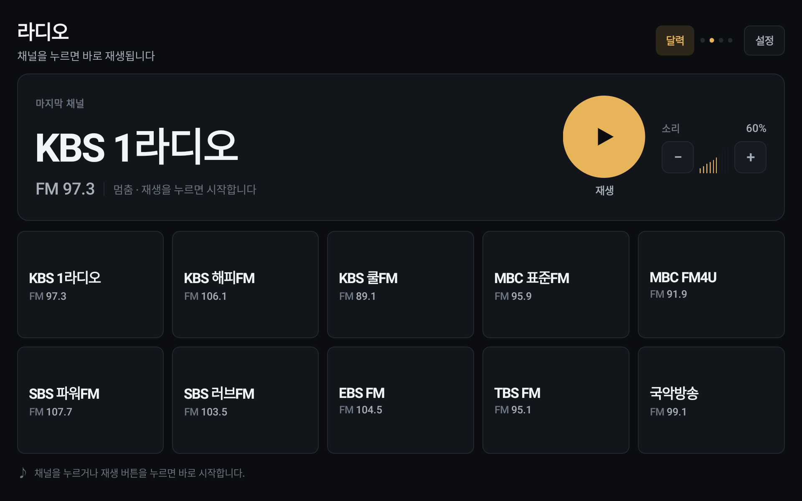 · 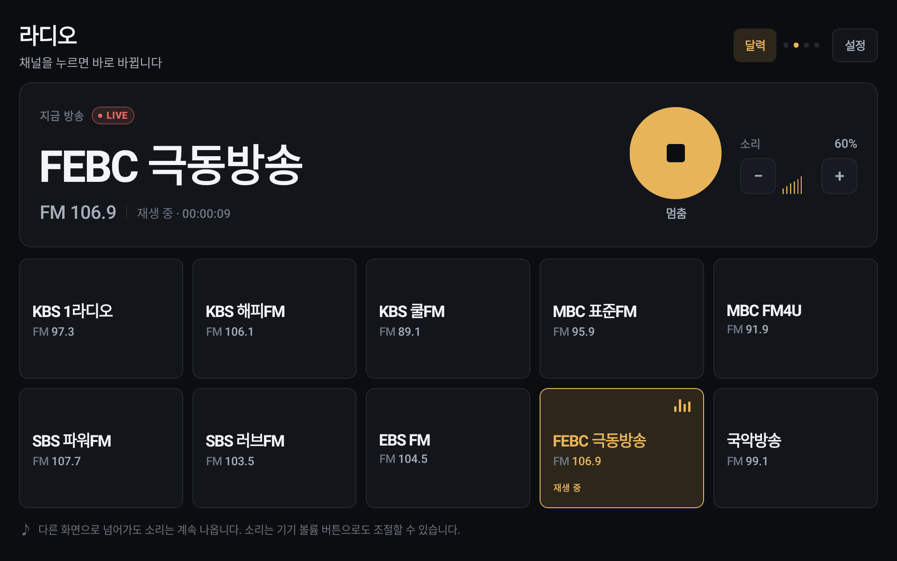 · 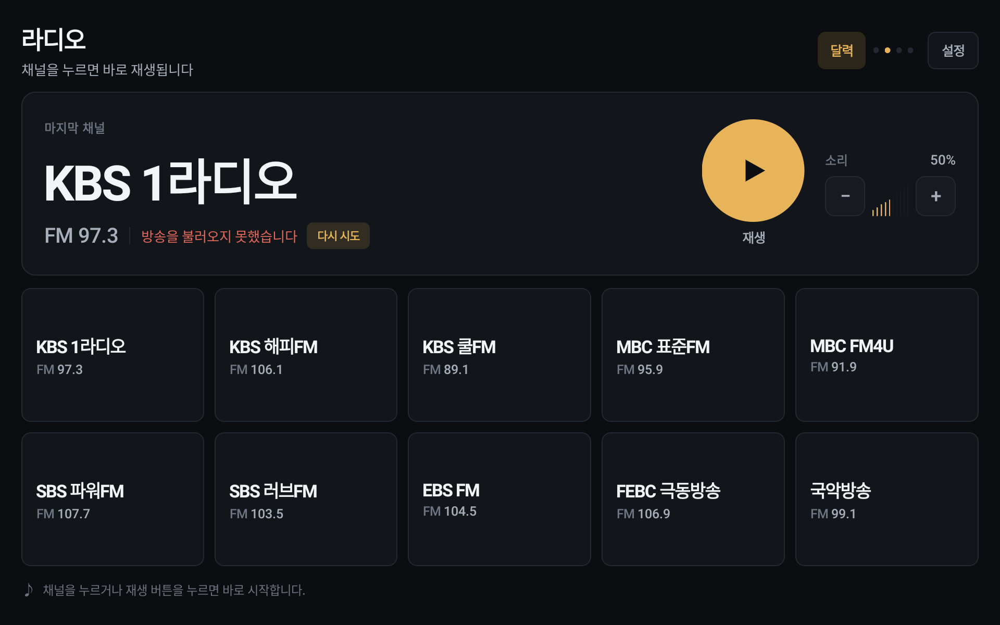

v0.4 TV: 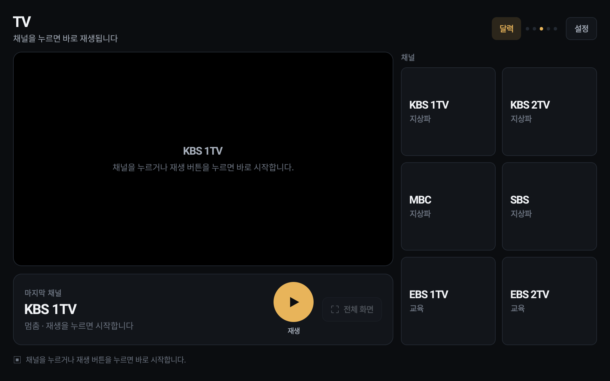 · 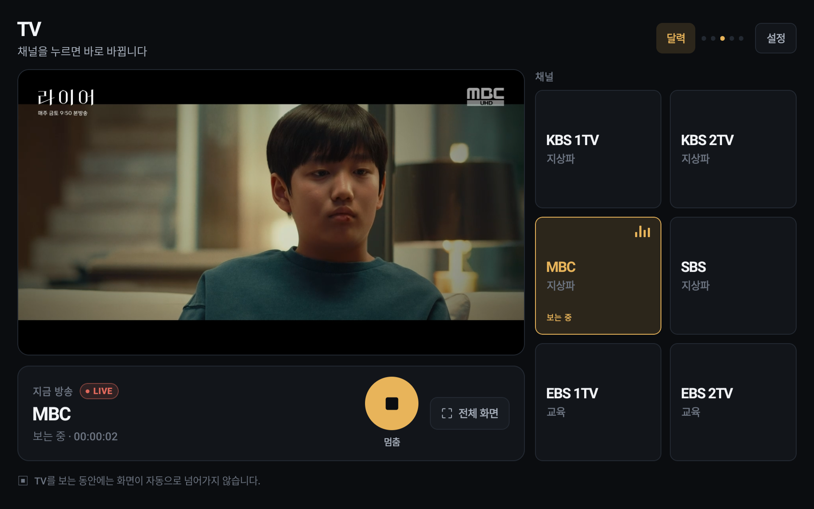 · 

v0.6 TV 채널: 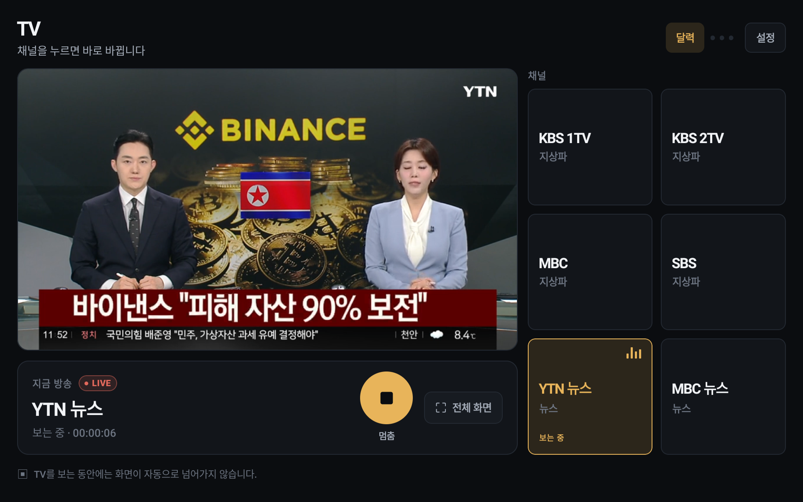


## 대상 기기

| 항목 | 값 |
|---|---|
| 기기 | Amazon Fire HD 10 (2019, 9세대) |
| OS | Fire OS 7 (Android 9, API 28) |
| 화면 | 1920×1200, 가로, 상시 켜짐 |
| Google 서비스 | **없음** (GMS 미탑재) |

Google Play Services 에 의존하지 않습니다. 날씨는 [Open-Meteo](https://open-meteo.com/)(키 불필요)를 씁니다. 기기가 위치를 알려 주면 그 자리를 쓰고, 못 찾으면 설정에서 한 번 검색해 저장한 동네를 씁니다([Nominatim](https://nominatim.openstreetmap.org/)). Fire HD 10(2019)은 GPS 가 없고 네트워크 위치도 좌표를 주지 않아, 이 기기에서는 저장한 동네가 날씨 지점이 됩니다.

## 기능

- 시계: 큰 시각 + 초, 요일·날짜, 12/24시간 선택, 둥근 아날로그·큰 디지털·혼합
- 달력: 음력·한국 공휴일·24절기·농사일이 함께 보이는 월 그리드, 오늘 강조, 이전/다음 달 이동
- 날짜 상세: 520dp 패널에 절기·농사일·공휴일·그날의 일정
- 일정: 날짜별 로컬 일정 추가·삭제, 양력/음력 기준과 매주·매월·매년 반복, 기기 캘린더 provider 가 있으면 기기 일정 읽기 전용 표시
- 날씨: 현재·체감·습도·바람·강수확률, 3시간별·7일 예보, 농사 참고, 비·눈·천둥 효과, 15분 주기 갱신
- 자동 전환: 달력 → 라디오 → TV → 날씨 → 시계(라디오·TV는 설정에서 제외 가능), 화면별 머무는 시간·터치 동작 설정, 카드 터치로 해당 화면 이동, 날씨·시계·라디오·TV의 `달력` 버튼으로 홈 복귀
- 라디오: 공식 무료 스트림 10개, 지금 방송 패널(재생/멈춤·볼륨), 달력의 `♪ 채널` 표시, 연결 실패 시 다시 시도
- TV: 채널 6개(KBS 1TV·2TV, MBC, SBS + YTN 뉴스·MBC 뉴스 유튜브 라이브), 16:9 영상(재생/멈춤·전체 화면), 보는 동안 자동 전환 정지, 연결 실패 시 다시 시도
- 키오스크 셸: 가로 고정, 몰입형 전체화면, 화면 꺼짐 방지, 화면 고정·부팅 자동 시작 선택
- 설정 패널(인앱): 날씨 지점(기기 위치 또는 저장한 동네), 일정, 시계 모양, 글씨 크기, 자동 전환, °C/°F, 12/24시간, 언어(시스템 / English / 한국어)

## 요구 사항

- JDK 17+ (Temurin 27 로 빌드 확인)
- Android SDK: platform 36, build-tools 36
- Gradle wrapper 9.5.0 (저장소 포함)

## 빌드

```bash
./gradlew assembleDebug
# 또는
./build_and_run.sh debug android
```

연결된 기기에 설치:

```bash
adb -s <serial> install -r app/build/outputs/apk/debug/app-debug.apk
```

## 테스트

```bash
./gradlew test
scripts/check-i18n.sh
```

## 문서

- `docs/plans/PLAN_v0.1_android.md` — v0.1 범위·예산·마일스톤
- `docs/plans/PLAN_v0.2_android.md` — v0.2 달력 재설계(구현 완료)
- `docs/mockups/v0.2/` — 상호작용 목업·캡처
- `docs/DESIGN.md` — 디자인 토큰·키오스크 레이아웃
- `docs/appstore/` — Amazon Appstore 등록 문안(en/ko)·Data safety
- `docs/TODO.md` — 후속 작업
- `docs/CHANGELOG.md` — 변경 기록

## 라이선스

비공개 프로젝트. 모든 권리 보유.
