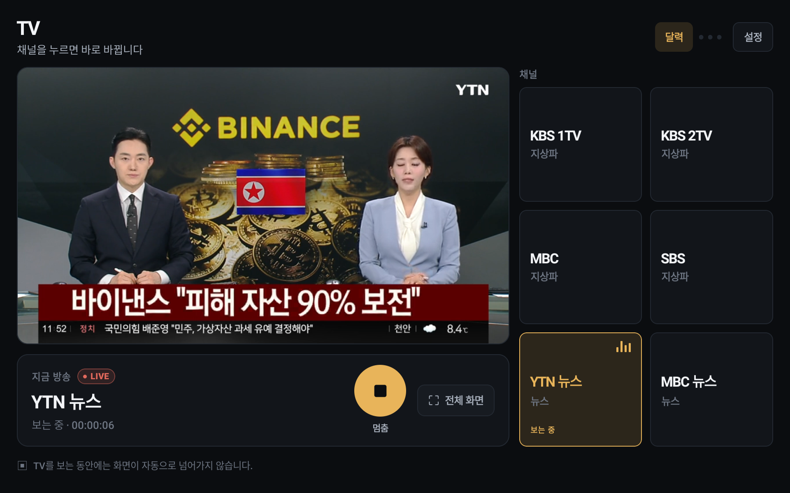
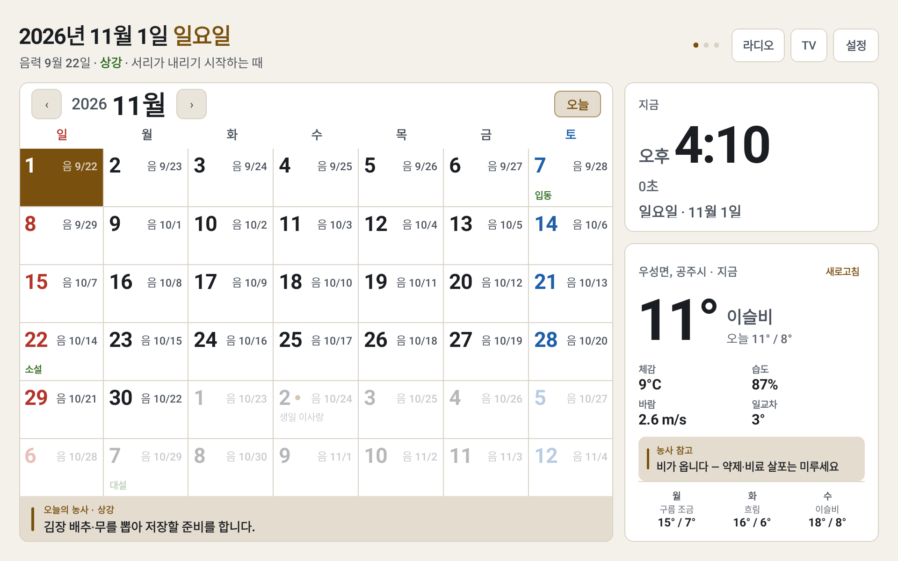
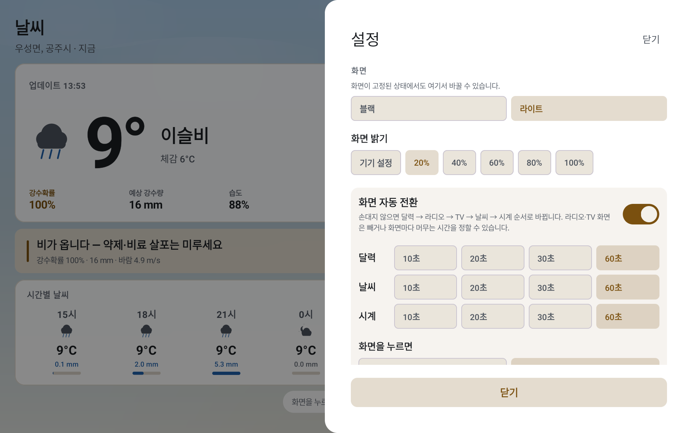
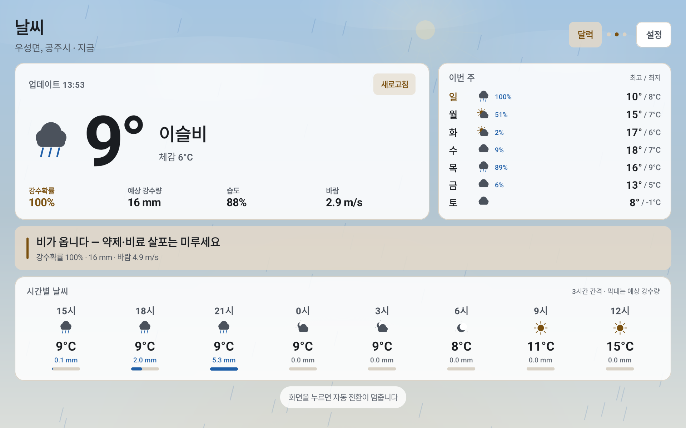
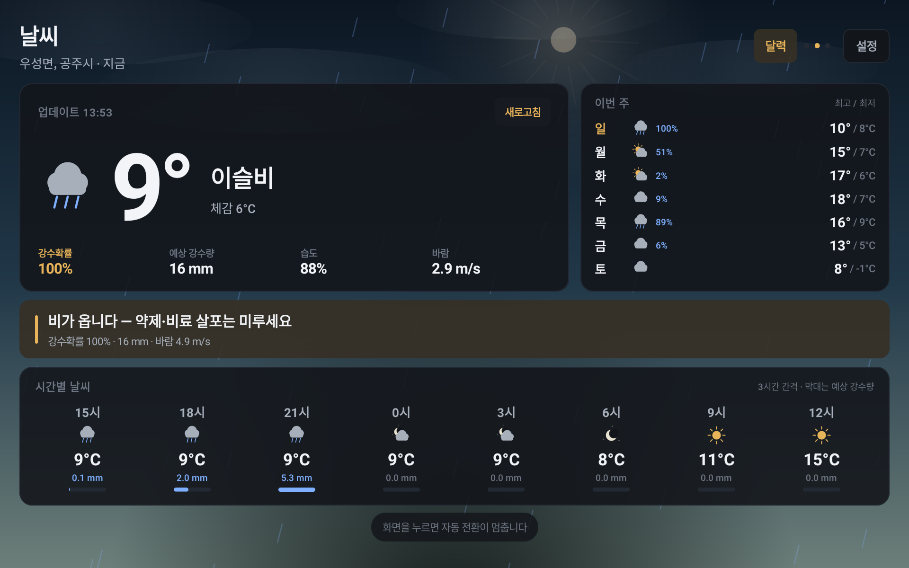
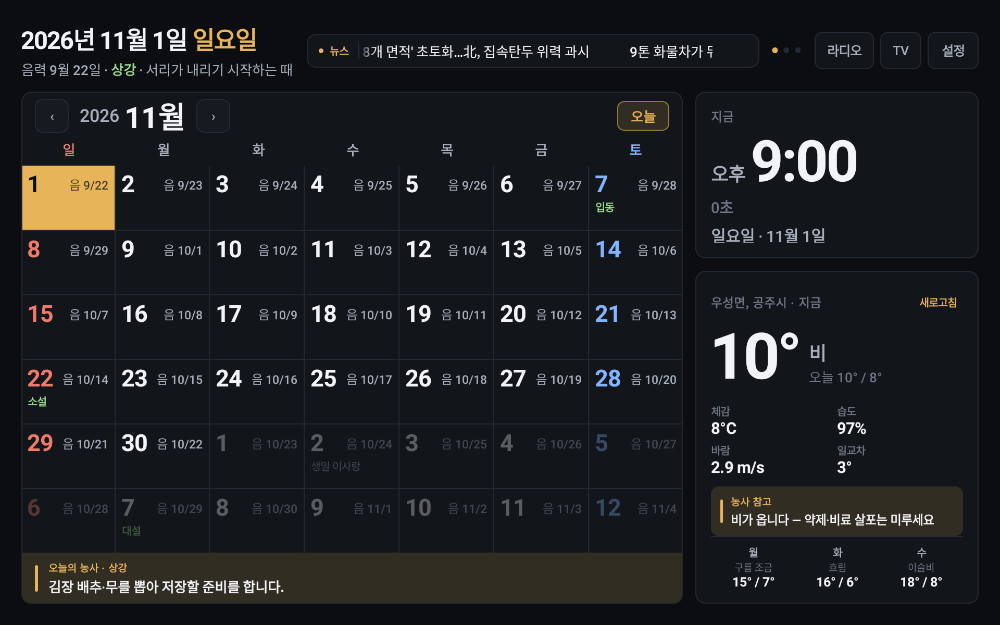
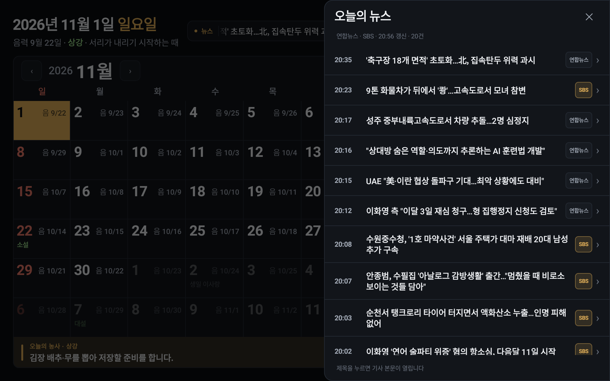
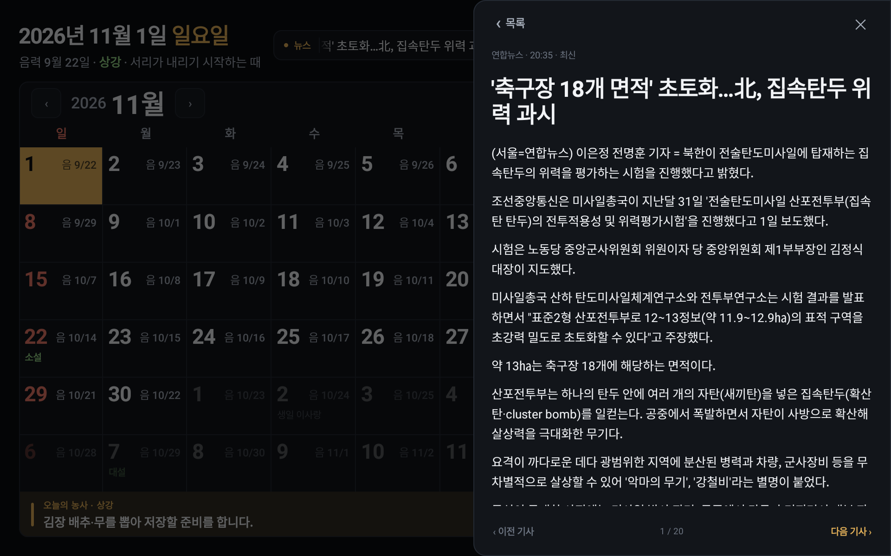
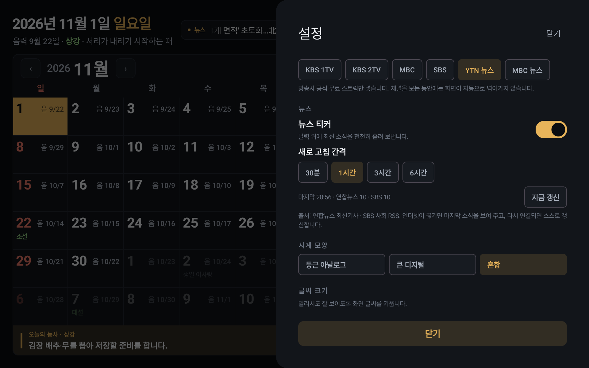

# DAON

[한국어](README.ko.md) · **English**

[](https://github.com/BoraSarang/DAON)
[](https://github.com/BoraSarang/DAON)
[](https://github.com/BoraSarang/DAON)
[](LICENSE)

A full-screen, always-on kiosk dashboard for an **Amazon Fire HD 10 (2019)** tablet: a large clock, the current month calendar, and live weather on a single dark screen — designed to be read from a few meters away.

## Status

**v0.9.0-dev** — a slowly scrolling **news ticker** in the calendar top bar (Yonhap + SBS), tap to read the list and full article in a side panel without ever leaving the kiosk. **v0.8.0-dev** — dark/light theme and in-app screen brightness, a time-of-day **weather backdrop**, and a cleaner calendar cell (inline lunar date, one event line, no clipped term names). **v0.6.0-dev** — TV channel change: EBS 1TV/2TV replaced by **YTN News** and **MBC News** (YouTube live, official embed). **v0.5.0-dev** — performance and memory pass (cold start 1.77s median, idle calendar 0 frames/20s) plus `Radio`/`TV` buttons in the calendar top bar. v0.4 added the TV screen (channel list, live video, full screen, rotation paused while watching); the v0.2 calendar-first redesign is implemented and on-device verification continues (T-006/T-007/T-021). The v0.1 baseline was verified on the target device: Fire HD 10 (2019), Fire OS 7.3.1.2 (API 28), 1920×1200 landscape, immersive full screen. Product name: **DAON** (다온).

| Metric | Budget | v0.1 | v0.2-dev | v0.3-dev | v0.4-dev | v0.5-dev | v0.6-dev | v0.8-dev | v0.9-dev |
|---|---|---|---|---|---|---|---|---|---|
| Cold start | ≤ 2.0s | 1.54s | 1.85–1.90s | 1.96s | 1.96s (median) | 1.774s (median) | 1.774s (median) | 1.844–1.864s | 1.959s (median) |
| Memory (PSS) | ≤ 250MB | 65.5MB | ~94MB (while running) | ~120MB (radio playing) | ~145MB (TV playing) | 100–115MB idle · 97MB radio · 126MB TV | 250MB peak (YouTube live) · 184MB after stop | 84MB calendar · 91MB weather | 108MB calendar |

## v0.9 — News ticker

The empty space between the date block and the right-hand buttons now carries a slowly scrolling **news ticker**. Two feeds — Yonhap (`https://www.yna.co.kr/rss/news.xml`) and SBS society (`...SectionRssFeed.do?sectionId=03`) — are fetched in parallel and merged into 20 headlines (10 each, newest first, one-sided shortage filled from the other), each row tagged with its source.

- The ticker flows left at 30dp/s with a **30fps cap**, animated purely through `graphicsLayer.translationX` (zero recomposition). It pauses whenever another screen, the settings panel, the date detail, the news panel or the background is in front.
- Tapping it opens a **600dp side panel** — list first, then the article. No browser, no WebView, no app switch: the kiosk stays pinned (`mLockTaskModeState=PINNED` was checked after every open/close).
- Article bodies are extracted on the fly — Yonhap strips `<figure>` and reads the `<p>`s (37 paragraphs), SBS decodes the JSON-LD `articleBody` and splits it into sentences (5 paragraphs). If extraction fails the RSS summary is shown with a note. Bodies are never cached.
- Refresh defaults to **1 hour** (30 min / 3 h / 6 h available) plus `Refresh now`. Headlines stay for 48 hours; a successful source replaces its items immediately, a failed source keeps its cache. Failures back off 5 → 15 → 60 minutes. All of this lives in the `News` section of settings, including `Last 20:56 · Yonhap 10 · SBS 10`.
- Offline behaviour: `E-AND-NEWS-0001/0002` are logged, the 57 cached headlines stay on screen with an `offline` label, and articles fall back to the summary. Everything recovers on its own once the network returns.
- On device: 92 tests (23 for news) and 301 i18n keys pass, cold start 1,954–1,978ms (budget 2.0s), PSS 108MB (budget 250MB). CPU while the ticker runs is 0.49 core and 0.0 with the ticker off — for reference the existing v0.8 rain scene costs 0.89 core.
- Captures: [`27`](docs/screenshots/27-v0.9-news-ticker-ko.png) (ticker) · [`28`](docs/screenshots/28-v0.9-news-panel-ko.png) (list) · [`29`](docs/screenshots/29-v0.9-news-article-ko.png) (article) · [`30`](docs/screenshots/30-v0.9-news-settings-ko.png) (settings `News`)

## v0.8 — Theme, brightness and weather backdrop

A pinned kiosk cannot reach the system settings, so theme and screen brightness moved into the app. The first settings section, `Screen`, switches the whole UI between black and light instantly, and brightness applies only to this app window (20/40/60/80/100% or system). The weather screen now paints a time-of-day sky on a `Canvas` instead of using photos (sun/moon/stars/clouds/field, dimmed under rain, snow or thunder). Calendar cells keep the lunar date inline on the right, and show the day's first event title on one line together with the term/holiday name.

- Theme: light palette `#F4F1EA`, white cards, accent `#7A500F`; body contrast 16.4:1, secondary 8.4:1. The saved theme is applied before the first frame, so there is no flash.
- Brightness: `WindowManager.LayoutParams.screenBrightness` on this window only — system auto-brightness and the lock screen are untouched. Re-applied in `onCreate` and `onResume`.
- Weather backdrop: zero assets. The time of day is checked once a minute and only the clouds tick at 0.4s (no 60fps loop). Turning off `Weather motion` stops the clouds too.
- Calendar cell: lunar date 16sp right-aligned, day 31sp, one 14sp event title; the term/holiday name shares that line so nothing clips at 115% text (12/22 `테스트` + `동지`).
- On device: 69 tests and 274 i18n keys pass, cold start 1.844–1.864s (budget 2.0s), PSS 84MB calendar / 91MB weather (budget 250MB), light and black verified.
- Captures: [`22`](docs/screenshots/22-v0.8-dashboard-light-ko.png) (light dashboard) · [`23`](docs/screenshots/23-v0.8-settings-screen-light-ko.png) (settings `Screen`) · [`24`](docs/screenshots/24-v0.8-weather-light-rain-ko.png) (light rain) · [`25`](docs/screenshots/25-v0.8-weather-black-rain-ko.png) (black rain) · [`26`](docs/screenshots/26-v0.8-calendar-event-december-ko.png) (December event and term)

## v0.6 — TV channels: YouTube live

EBS 1TV/2TV are gone; **YTN News** (`aZyD6EPl6KU`) and **MBC News** (`q9bM12ucTIY`) join KBS 1TV/2TV, MBC and SBS — still six channels. YouTube does not hand out an HLS/DASH manifest (the watch page only exposes `adaptiveFormats`), so ExoPlayer cannot play these two. They run in YouTube's **official IFrame embed player** inside a WebView (`app/src/main/assets/yt_player.html`) served from `https://appassets.androidplatform.net` with `WebViewAssetLoader`; loading the same page with `loadDataWithBaseURL` fails with player error `152` because YouTube cannot verify the referer. Play/stop, channel switching, the LIVE badge and full screen behave exactly like the other channels: the same WebView is moved into the full-screen layout so the stream does not restart. It is destroyed when playback stops or the screen is left, and an error (offline / embed blocked / 25-second timeout) shows the usual retry row.

- Memory: about **250MB PSS while a YouTube channel plays** (the budget ceiling) and about 184MB after it is released; Chromium keeps roughly 100MB until the process restarts. The four terrestrial channels keep using ExoPlayer (~126MB).
- Verified on the target device (Fire OS 7 WebView, Chromium 70): YTN and MBC News play, full screen keeps the stream, switching between YouTube and HLS channels releases the right player. Tests 65 (two new catalog tests for YouTube ids).
- Capture: [`21-v0.6-tv-youtube-ko.png`](docs/screenshots/21-v0.6-tv-youtube-ko.png) (YTN News playing next to the six-channel list)

## v0.5 — Performance and memory

Startup work (calendar assets, weather, location, device calendar, stored events) moved behind the first frame, so the calendar appears sooner. The clock tick no longer lives in the ViewModel: a `rememberNow(perSecond)` helper updates the clock screen every second and the calendar/weather screens only on the minute boundary, so the 42-cell calendar is no longer recomposed every second. Repeat-event expansion runs on `Dispatchers.Default`, `DateTimeFormatter` instances are cached, and the inactive ExoPlayer is released when switching between radio and TV. The calendar top bar now also has `Radio` and `TV` buttons, so both screens stay reachable when they are excluded from the rotation (the `Radio` button is highlighted while the radio plays).

- Measured on the target device: cold start 1.767–1.793s over 5 runs (median 1.774s, was 1.945–2.021s); calendar screen 0 frames in 20 idle seconds; PSS 100–115MB on the calendar, 97MB with radio playing, 126MB with TV playing; 250MB peak and 184MB after stopping a YouTube channel.
- The `budget=2000ms` value in the log is informational only — exceeding it never stops the app.
- Captures: [`19-v0.5-dashboard-nav-ko.png`](docs/screenshots/19-v0.5-dashboard-nav-ko.png) (Radio/TV buttons in the top bar) · [`20-v0.5-radio-active-nav-ko.png`](docs/screenshots/20-v0.5-radio-active-nav-ko.png) (Radio button highlighted while the radio plays)

## v0.4 — TV

A fifth screen, calendar → radio → **TV** → weather → clock. Six official free streams (KBS 1TV/2TV, MBC, SBS, EBS 1TV/2TV — v0.6 replaced the two EBS channels with YTN News and MBC News) in a 2×3 list next to a 16:9 video stage. Tapping a channel starts it immediately; the stream URL is resolved on every play because broadcasters hand out short-lived tokens (SBS uses a 60-second JWT, and MBC's CDN returns 403 without a `Referer` header). A large play/stop button and a `Full screen` button sit under the video, and `Exit full screen` returns to the list.

**While TV is playing — including in full screen — the automatic screen rotation stops.** Stopping the channel or leaving the TV screen resumes it. Leaving the screen (the `Calendar` button, back, or the app going to the background) also stops playback, and starting the radio stops the TV and vice versa, so the two never play at once. A `TV` section in settings controls whether the screen joins the rotation, its dwell time, and the default channel.

- Plan: [`docs/plans/PLAN_v0.4_tv.md`](docs/plans/PLAN_v0.4_tv.md)
- Captures: [`16-v0.4-tv-ko.png`](docs/screenshots/16-v0.4-tv-ko.png) · [`17-v0.4-tv-playing-ko.png`](docs/screenshots/17-v0.4-tv-playing-ko.png) · [`18-v0.4-tv-fullscreen-ko.png`](docs/screenshots/18-v0.4-tv-fullscreen-ko.png)
- Playback: Media3 ExoPlayer + `media3-ui` PlayerView, H.264/AAC HLS, no GMS. The player is created on the first play so the cold-start budget is untouched.
- Streams: official free HLS only. MBC needs `Referer`/`Origin` on the media request; SBS `http://` URLs are upgraded to `https://` because the device blocks cleartext.

## v0.3 — radio

A fourth screen, calendar → **radio** → weather → clock. Ten official free streams (KBS, MBC, SBS, EBS, FEBC, Gugak FM) in a 5×2 grid with a large now-playing panel: channel name, FM frequency, LIVE badge, play/stop, and a 10-step volume control. Tapping a channel starts it immediately; the stream URL is resolved on every play because broadcasters hand out short-lived tokens. Audio keeps playing while the screens rotate, the calendar shows a `♪ channel` pill that returns to the radio screen, and a `Radio` section in settings controls whether the screen joins the rotation, its dwell time, the default channel, and autoplay on startup. Streams come over the internet, so a dropped connection shows `Could not load the broadcast` with a retry button.

- Mockup: [`docs/mockups/v0.3-radio/index.html`](docs/mockups/v0.3-radio/index.html) · plan: [`docs/plans/PLAN_v0.3_radio.md`](docs/plans/PLAN_v0.3_radio.md)
- Captures: [`13-v0.3-radio-ko.png`](docs/screenshots/13-v0.3-radio-ko.png) · [`14-v0.3-radio-playing-ko.png`](docs/screenshots/14-v0.3-radio-playing-ko.png) · [`15-v0.3-radio-error-ko.png`](docs/screenshots/15-v0.3-radio-error-ko.png)
- Playback: Media3 ExoPlayer 1.5.1 + HLS (no GMS). Audio focus is handled by ExoPlayer; playback stops when the app leaves the foreground.
- Streams: official free HLS only. TBS FM was dropped because its CDN uses a GlobalSign R46 root that Fire OS 7 does not trust; FEBC FM (106.9) replaced it.


## v0.2 — calendar-first kiosk

Calendar 70% + clock/weather 30%, lunar dates, Korean public holidays, 24 solar terms with farming notes, and an idle rotation calendar → weather → clock. Tap a date for a 520dp panel with the solar term, farming tasks, holidays, and events. Weather shows current, 3-hourly, and 7-day forecasts with rain chance and rain/snow/thunder effects. The clock face can be a round analog, large digital, or combined.

Events can be added on the tablet with a **solar or lunar date basis** and an optional **weekly / monthly / yearly repeat** (lunar events repeat yearly on the same lunar day). When the device has a calendar provider, its events are shown read-only. Tap the clock or weather card to open that screen; a `Calendar` button on those screens returns to the dashboard even in pause-on-this-screen mode. Kiosk settings add screen pinning and optional start-on-boot.

- Interactive mockup: [`docs/mockups/v0.2/index.html`](docs/mockups/v0.2/index.html)
- v0.2 captures: [`docs/screenshots/04-v0.2-dashboard-ko.png`](docs/screenshots/04-v0.2-dashboard-ko.png) … `10-v0.2-settings-ko.png`
- Local events: SharedPreferences JSON, with weekly/monthly/yearly repeats and a lunar date basis. Device calendar: `READ_CALENDAR`, ±12 months; Fire OS 7 has a calendar provider, so events show once the permission is granted (0 events when no account is set up).
- Kiosk: Android screen pinning; device owner is optional (`adb shell dpm set-device-owner com.borasarang.daon/.admin.AdminReceiver`).

## Screenshots

| v0.2 calendar | Date detail | Weather | Clock | Settings |
|---|---|---|---|---|
|  |  |  |  |  |

v0.1:  · 

v0.3 radio:  ·  · 

v0.4 TV:  ·  · 

v0.6 TV channels: 

v0.8 theme and weather:  ·  ·  · 

v0.9 news:  ·  ·  · 


## Target device

| Item | Value |
|---|---|
| Device | Amazon Fire HD 10 (2019, 9th gen) |
| OS | Fire OS 7 (Android 9, API 28) |
| Display | 1920×1200, landscape, always-on |
| Google services | **Not available** (no GMS) |

The app avoids Google Play Services entirely. Weather comes from [Open-Meteo](https://open-meteo.com/) (no API key). Weather uses the device's own location when the tablet can provide one; when it cannot, a neighborhood searched once in Settings (via [Nominatim](https://nominatim.openstreetmap.org/)) is used instead. The Fire HD 10 (2019) has no GPS and its network location provider never returns a fix, so on that unit the saved neighborhood is what drives the weather.

## Features

- Clock: large time with seconds, weekday and date; 12/24-hour option; round analog / large digital / combined face
- Calendar: month grid with lunar dates, Korean public holidays, 24 solar terms, and farming notes; today highlighted; month navigation
- Date detail: 520dp panel with the solar term, farming tasks, holidays, and that day's events
- Events: add/delete local events per day, with weekly/monthly/yearly repeats and a solar/lunar date basis; read device-calendar events when the tablet has a calendar provider
- Weather: current, feels-like, humidity, wind, rain chance, 3-hourly and 7-day forecasts, farming note, rain/snow/thunder effects, 15-minute refresh
- Rotation: calendar → radio → TV → weather → clock (the radio and TV screens can be excluded) with per-screen dwell time and two tap behaviours; tap a dashboard card to open that screen, and the `Calendar` button on weather/clock/radio/TV returns home
- Radio: 10 official free streams, large now-playing panel with play/stop and volume, `♪ channel` pill on the calendar, retry on network failure
- TV: 6 channels (KBS 1TV/2TV, MBC, SBS + YTN News and MBC News YouTube live), 16:9 video with play/stop and full screen, rotation paused while watching, retry on network failure
- Kiosk shell: landscape lock, immersive full screen, keep-screen-on, optional screen pinning and start-on-boot
- Settings panel (in-app): weather point (device location or saved neighborhood), events, clock face, text size, rotation, °C/°F, 12/24-hour, language (System / English / 한국어)

## Requirements

- JDK 17+ (project builds with Temurin 27)
- Android SDK: platform 36, build-tools 36
- Gradle wrapper 9.5.0 (bundled)

## Build

```bash
./gradlew assembleDebug
# or
./build_and_run.sh debug android
```

Install on a connected device:

```bash
adb -s <serial> install -r app/build/outputs/apk/debug/app-debug.apk
```

## Test

```bash
./gradlew test
scripts/check-i18n.sh
```

## Documentation

- `docs/plans/PLAN_v0.1_android.md` — v0.1 scope, budgets, milestones
- `docs/plans/PLAN_v0.2_android.md` — v0.2 calendar redesign (implemented)
- `docs/plans/PLAN_v0.3_radio.md` — v0.3 radio screen (implemented)
- `docs/plans/PLAN_v0.4_tv.md` — v0.4 TV screen (implemented)
- `docs/plans/PLAN_v0.9_news.md` — v0.9 news ticker, panel and refresh rules (implemented)
- `docs/mockups/` — interactive mockups (v0.2, v0.3 radio, v0.7 weather, v0.9 news)
- `docs/DESIGN.md` — design tokens and kiosk layout
- `docs/appstore/` — Amazon Appstore listing (en/ko) and data safety
- `docs/TODO.md` — follow-up work
- `docs/CHANGELOG.md` — change log

## License

MIT License — see [LICENSE](LICENSE).
