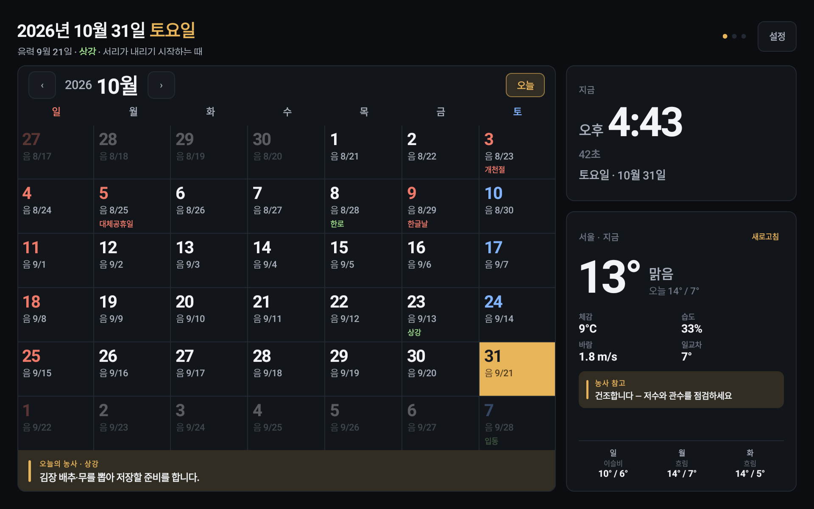
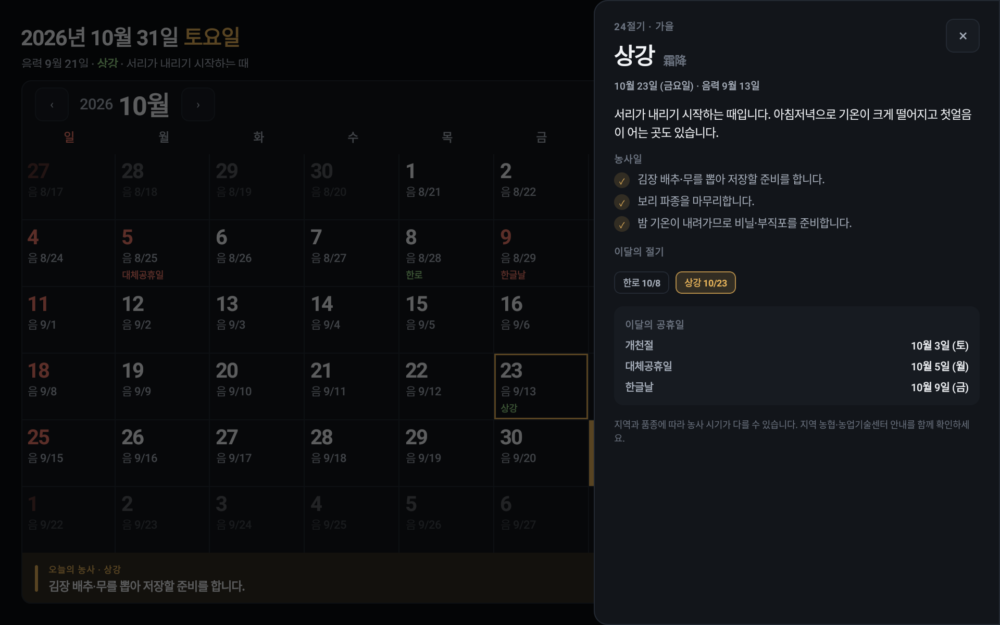
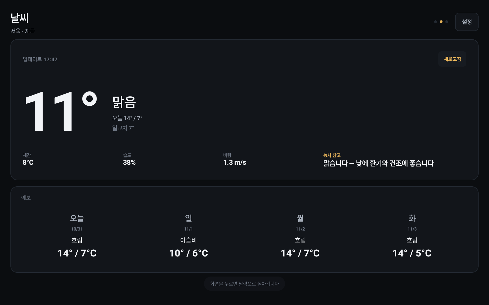
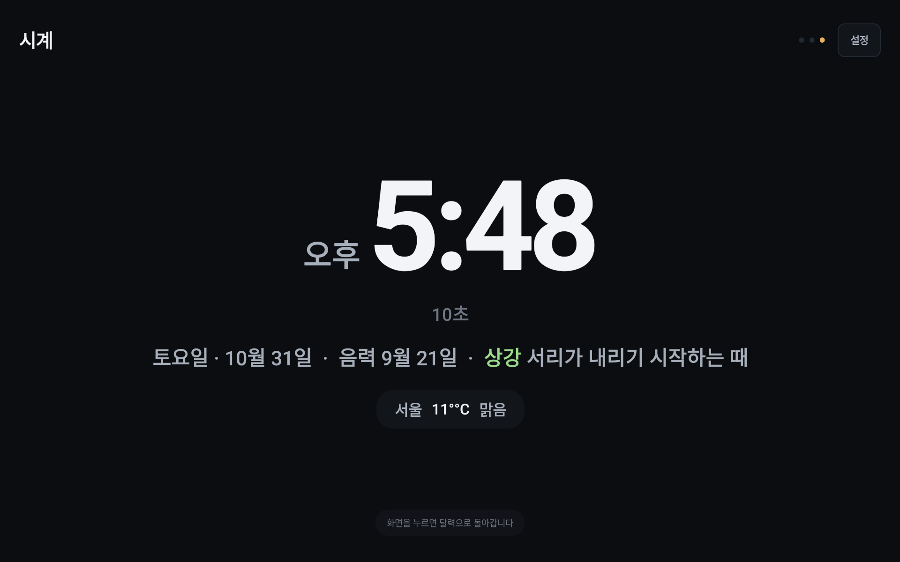
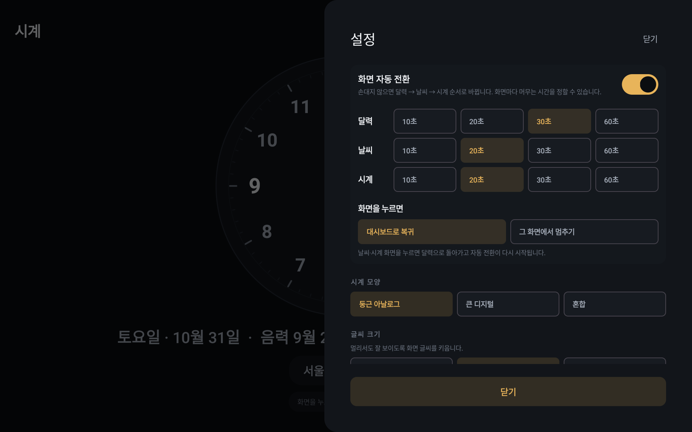
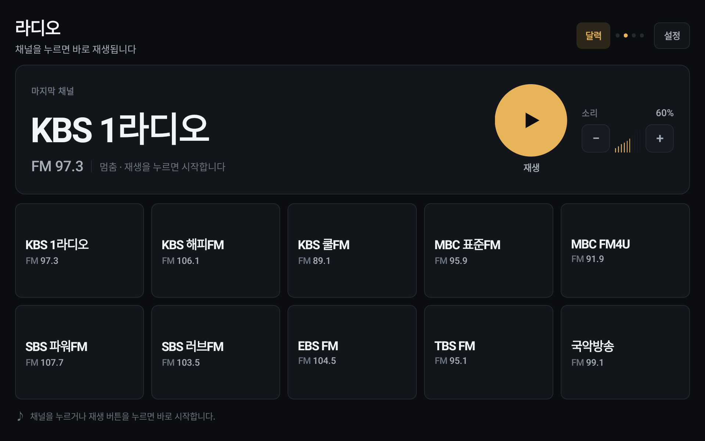
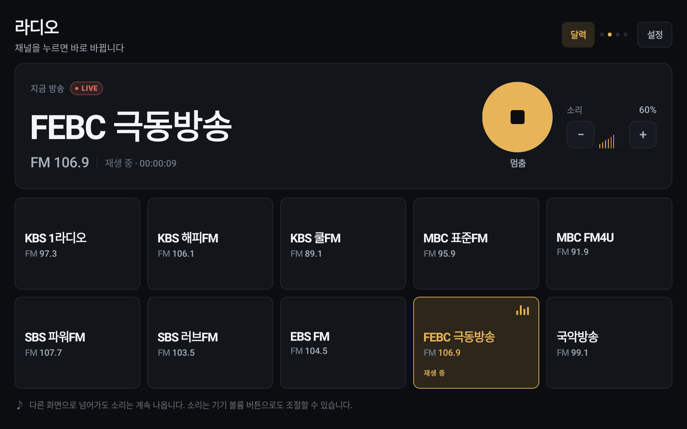
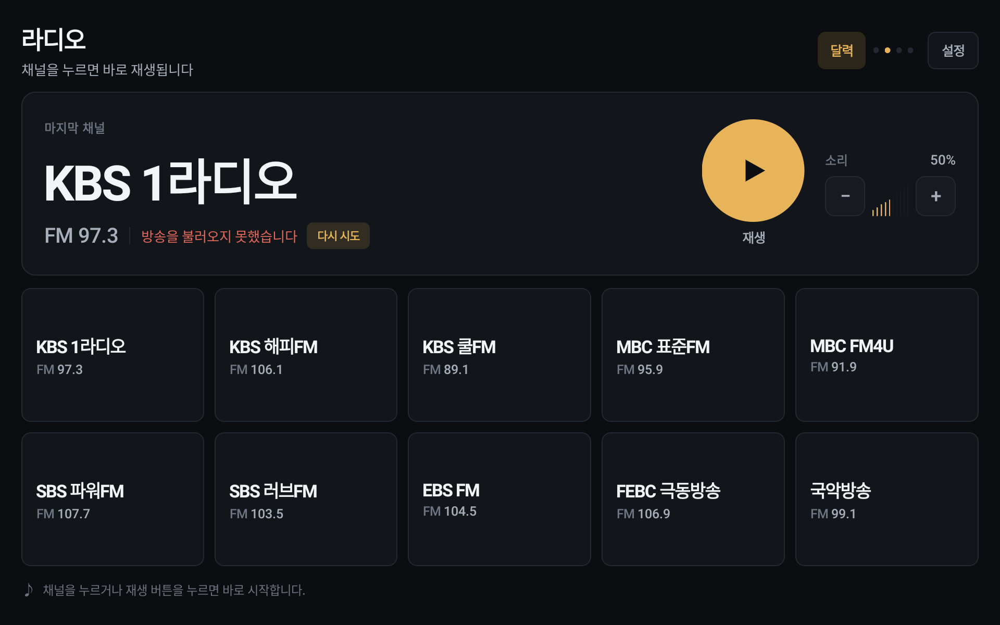
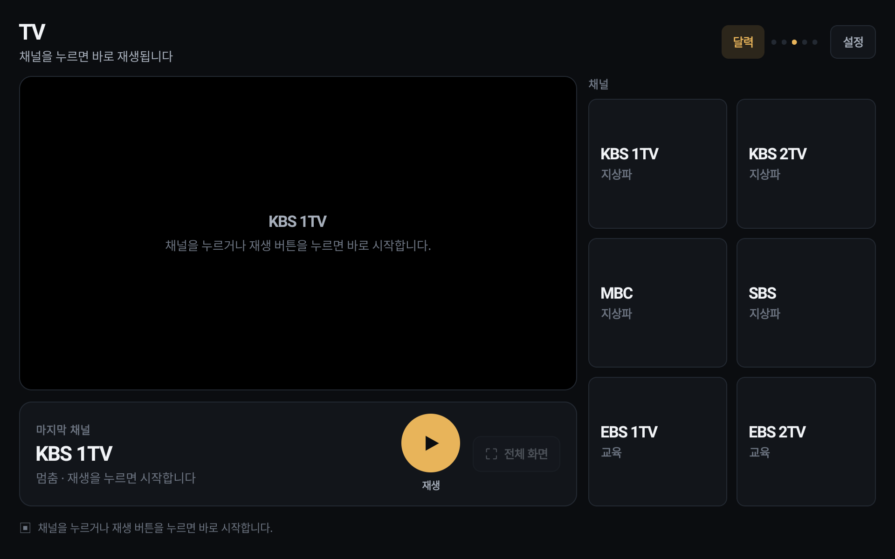
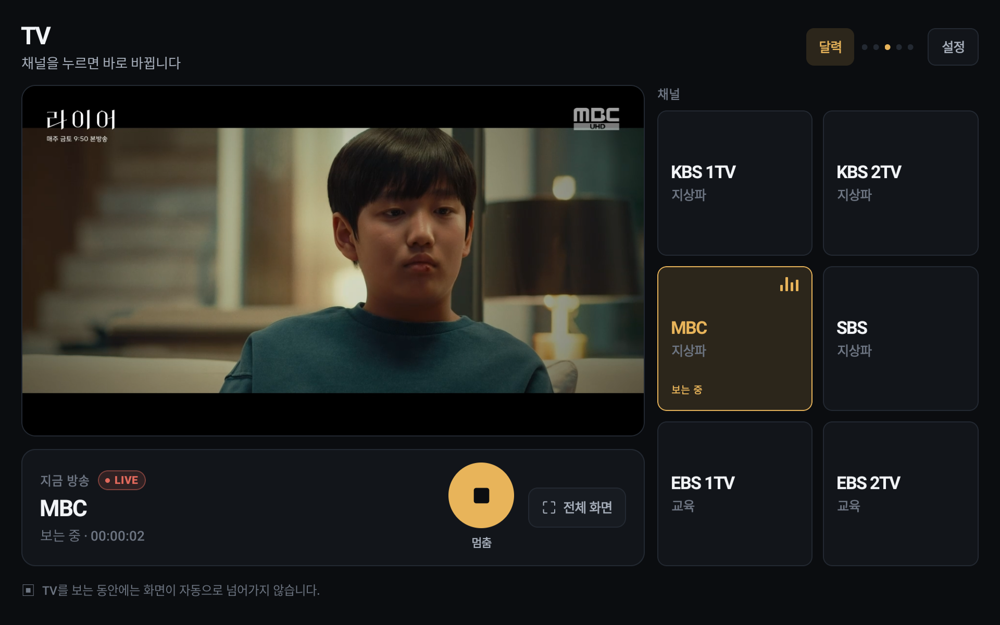

# DAON

[한국어](README.ko.md) · **English**

A full-screen, always-on kiosk dashboard for an **Amazon Fire HD 10 (2019)** tablet: a large clock, the current month calendar, and live weather on a single dark screen — designed to be read from a few meters away.

## Status

**v0.4.0-dev** — TV screen added (channel list, live video, full screen, rotation paused while watching); v0.2 calendar-first redesign is implemented and on-device verification continues (T-006/T-007/T-021). The v0.1 baseline was verified on the target device: Fire HD 10 (2019), Fire OS 7.3.1.2 (API 28), 1920×1200 landscape, immersive full screen. Product name: **DAON** (다온).

| Metric | Budget | v0.1 | v0.2-dev | v0.3-dev | v0.4-dev |
|---|---|---|---|---|---|
| Cold start | ≤ 2.0s | 1.54s | 1.85–1.90s | 1.96s | 1.96s (median) |
| Memory (PSS) | ≤ 250MB | 65.5MB | ~94MB (while running) | ~120MB (radio playing) | ~145MB (TV playing) |

## v0.4 — TV

A fifth screen, calendar → radio → **TV** → weather → clock. Six official free streams (KBS 1TV/2TV, MBC, SBS, EBS 1TV/2TV) in a 2×3 list next to a 16:9 video stage. Tapping a channel starts it immediately; the stream URL is resolved on every play because broadcasters hand out short-lived tokens (SBS uses a 60-second JWT, and MBC's CDN returns 403 without a `Referer` header). A large play/stop button and a `Full screen` button sit under the video, and `Exit full screen` returns to the list.

**While TV is playing — including in full screen — the automatic screen rotation stops.** Stopping the channel or leaving the TV screen resumes it. Leaving the screen (the `Calendar` button, back, or the app going to the background) also stops playback, and starting the radio stops the TV and vice versa, so the two never play at once. A `TV` section in settings controls whether the screen joins the rotation, its dwell time, and the default channel.

- Plan: [`docs/plans/PLAN_v0.4_tv.md`](docs/plans/PLAN_v0.4_tv.md)
- Captures: [`16-v0.4-tv-ko.png`](docs/screenshots/16-v0.4-tv-ko.png) · [`17-v0.4-tv-playing-ko.png`](docs/screenshots/17-v0.4-tv-playing-ko.png) · [`18-v0.4-tv-fullscreen-ko.png`](docs/screenshots/18-v0.4-tv-fullscreen-ko.png)
- Playback: Media3 ExoPlayer + `media3-ui` PlayerView, H.264/AAC HLS, no GMS. The player is created on the first play so the cold-start budget is untouched.
- Streams: official free HLS only. MBC needs `Referer`/`Origin` on the media request; SBS `http://` URLs are upgraded to `https://` because the device blocks cleartext.

## v0.3 — radio

A fourth screen, calendar → **radio** → weather → clock. Ten official free streams (KBS, MBC, SBS, EBS, FEBC, Gugak FM) in a 5×2 grid with a large now-playing panel: channel name, FM frequency, LIVE badge, play/stop, and a 10-step volume control. Tapping a channel starts it immediately; the stream URL is resolved on every play because broadcasters hand out short-lived tokens. Audio keeps playing while the screens rotate, the calendar shows a `♪ channel` pill that returns to the radio screen, and a `Radio` section in settings controls whether the screen joins the rotation, its dwell time, the default channel, and autoplay on startup. Streams come over the internet, so a dropped connection shows `Could not load the broadcast` with a retry button.

- Mockup: [`docs/mockups/v0.3-radio/index.html`](docs/mockups/v0.3-radio/index.html) · plan: [`docs/plans/PLAN_v0.3_radio.md`](docs/plans/PLAN_v0.3_radio.md)
- Captures: [`13-v0.3-radio-ko.png`](docs/screenshots/13-v0.3-radio-ko.png) · [`14-v0.3-radio-playing-ko.png`](docs/screenshots/14-v0.3-radio-playing-ko.png) · [`15-v0.3-radio-error-ko.png`](docs/screenshots/15-v0.3-radio-error-ko.png)
- Playback: Media3 ExoPlayer 1.5.1 + HLS (no GMS). Audio focus is handled by ExoPlayer; playback stops when the app leaves the foreground.
- Streams: official free HLS only. TBS FM was dropped because its CDN uses a GlobalSign R46 root that Fire OS 7 does not trust; FEBC FM (106.9) replaced it.


## v0.2 — calendar-first kiosk

Calendar 70% + clock/weather 30%, lunar dates, Korean public holidays, 24 solar terms with farming notes, and an idle rotation calendar → weather → clock. Tap a date for a 520dp panel with the solar term, farming tasks, holidays, and events. Weather shows current, 3-hourly, and 7-day forecasts with rain chance and rain/snow/thunder effects. The clock face can be a round analog, large digital, or combined.

Events can be added on the tablet with a **solar or lunar date basis** and an optional **weekly / monthly / yearly repeat** (lunar events repeat yearly on the same lunar day). When the device has a calendar provider, its events are shown read-only. Tap the clock or weather card to open that screen; a `Calendar` button on those screens returns to the dashboard even in pause-on-this-screen mode. Kiosk settings add screen pinning and optional start-on-boot.

- Interactive mockup: [`docs/mockups/v0.2/index.html`](docs/mockups/v0.2/index.html)
- v0.2 captures: [`docs/screenshots/04-v0.2-dashboard-ko.png`](docs/screenshots/04-v0.2-dashboard-ko.png) … `10-v0.2-settings-ko.png`
- Local events: SharedPreferences JSON, with weekly/monthly/yearly repeats and a lunar date basis. Device calendar: `READ_CALENDAR`, ±12 months; Fire OS 7 has a calendar provider, so events show once the permission is granted (0 events when no account is set up).
- Kiosk: Android screen pinning; device owner is optional (`adb shell dpm set-device-owner com.borasarang.daon/.admin.AdminReceiver`).

## Screenshots

| v0.2 calendar | Date detail | Weather | Clock | Settings |
|---|---|---|---|---|
|  |  |  |  |  |

v0.1:  · 

v0.3 radio:  ·  · 

v0.4 TV:  ·  · 


## Target device

| Item | Value |
|---|---|
| Device | Amazon Fire HD 10 (2019, 9th gen) |
| OS | Fire OS 7 (Android 9, API 28) |
| Display | 1920×1200, landscape, always-on |
| Google services | **Not available** (no GMS) |

The app avoids Google Play Services entirely. Weather comes from [Open-Meteo](https://open-meteo.com/) (no API key). Weather uses the device's own location when the tablet can provide one; when it cannot, a neighborhood searched once in Settings (via [Nominatim](https://nominatim.openstreetmap.org/)) is used instead. The Fire HD 10 (2019) has no GPS and its network location provider never returns a fix, so on that unit the saved neighborhood is what drives the weather.

## Features

- Clock: large time with seconds, weekday and date; 12/24-hour option; round analog / large digital / combined face
- Calendar: month grid with lunar dates, Korean public holidays, 24 solar terms, and farming notes; today highlighted; month navigation
- Date detail: 520dp panel with the solar term, farming tasks, holidays, and that day's events
- Events: add/delete local events per day, with weekly/monthly/yearly repeats and a solar/lunar date basis; read device-calendar events when the tablet has a calendar provider
- Weather: current, feels-like, humidity, wind, rain chance, 3-hourly and 7-day forecasts, farming note, rain/snow/thunder effects, 15-minute refresh
- Rotation: calendar → radio → TV → weather → clock (the radio and TV screens can be excluded) with per-screen dwell time and two tap behaviours; tap a dashboard card to open that screen, and the `Calendar` button on weather/clock/radio/TV returns home
- Radio: 10 official free streams, large now-playing panel with play/stop and volume, `♪ channel` pill on the calendar, retry on network failure
- TV: 6 official free streams, 16:9 video with play/stop and full screen, rotation paused while watching, retry on network failure
- Kiosk shell: landscape lock, immersive full screen, keep-screen-on, optional screen pinning and start-on-boot
- Settings panel (in-app): weather point (device location or saved neighborhood), events, clock face, text size, rotation, °C/°F, 12/24-hour, language (System / English / 한국어)

## Requirements

- JDK 17+ (project builds with Temurin 27)
- Android SDK: platform 36, build-tools 36
- Gradle wrapper 9.5.0 (bundled)

## Build

```bash
./gradlew assembleDebug
# or
./build_and_run.sh debug android
```

Install on a connected device:

```bash
adb -s <serial> install -r app/build/outputs/apk/debug/app-debug.apk
```

## Test

```bash
./gradlew test
scripts/check-i18n.sh
```

## Documentation

- `docs/plans/PLAN_v0.1_android.md` — v0.1 scope, budgets, milestones
- `docs/plans/PLAN_v0.2_android.md` — v0.2 calendar redesign (implemented)
- `docs/mockups/v0.2/` — interactive mockup and captures
- `docs/DESIGN.md` — design tokens and kiosk layout
- `docs/appstore/` — Amazon Appstore listing (en/ko) and data safety
- `docs/TODO.md` — follow-up work
- `docs/CHANGELOG.md` — change log

## License

Private project. All rights reserved.
