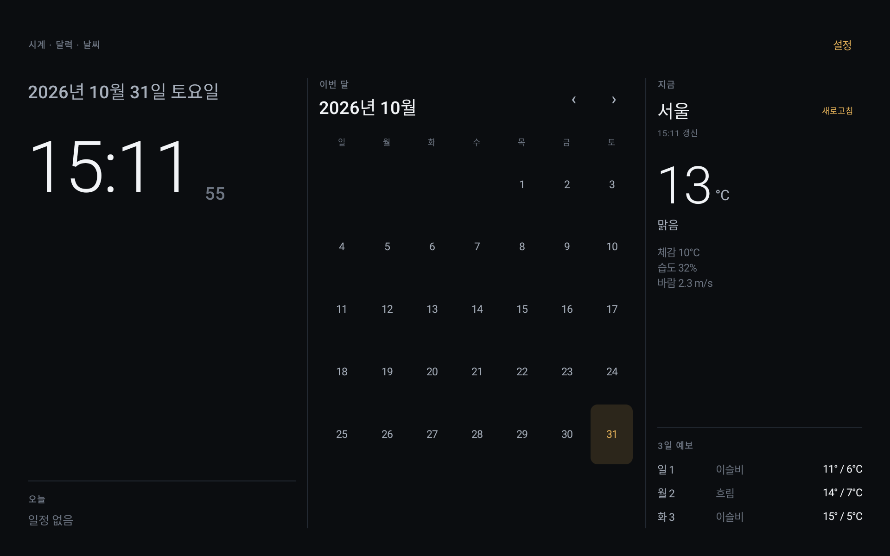
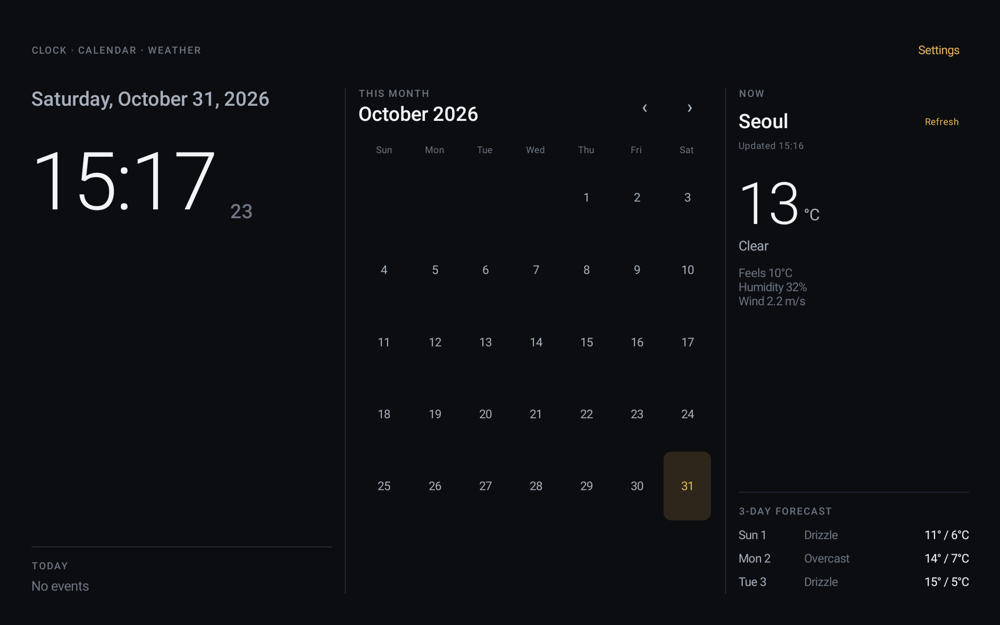
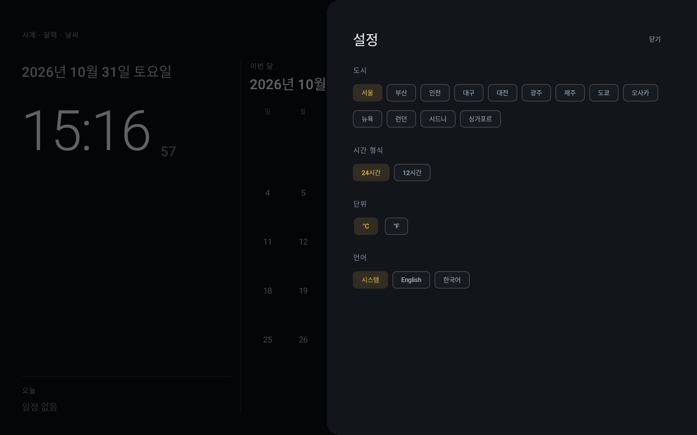

# DAON

[한국어](README.ko.md) · **English**

A full-screen, always-on kiosk dashboard for an **Amazon Fire HD 10 (2019)** tablet: a large clock, the current month calendar, and live weather on a single dark screen — designed to be read from a few meters away.

## Status

Early scaffold (v0.1.0) — **verified on the target device**: Fire HD 10 (2019), Fire OS 7.3.1.2 (API 28), 1920×1200 landscape, immersive full screen.

| Metric | Budget | Measured |
|---|---|---|
| Cold start | ≤ 2.0s | 1.54s |
| Memory (PSS) | ≤ 250MB | 65.5MB |

## Screenshots

| Korean | English | Settings |
|---|---|---|
|  |  |  |


## Target device

| Item | Value |
|---|---|
| Device | Amazon Fire HD 10 (2019, 9th gen) |
| OS | Fire OS 7 (Android 9, API 28) |
| Display | 1920×1200, landscape, always-on |
| Google services | **Not available** (no GMS) |

The app avoids Google Play Services entirely. Weather comes from [Open-Meteo](https://open-meteo.com/) (no API key), and the city is chosen manually instead of using location services.

## Features (v0.1)

- Clock: large HH:mm with seconds, weekday and date; 12/24-hour option
- Calendar: current month grid, today highlighted, previous/next month navigation
- Weather: current temperature, feels-like, humidity, wind, plus a 3-day forecast, refreshed every 15 minutes
- Kiosk shell: landscape lock, immersive full screen, keep-screen-on
- Settings sheet: city, 12/24-hour, °C/°F, language (System / English / 한국어)

## Requirements

- JDK 17+ (project builds with Temurin 27)
- Android SDK: platform 36, build-tools 36
- Gradle wrapper 9.5.0 (bundled)

## Build

```bash
./gradlew assembleDebug
# or
./build_and_run.sh debug android
```

Install on a connected device:

```bash
adb -s <serial> install -r app/build/outputs/apk/debug/app-debug.apk
```

## Test

```bash
./gradlew test
scripts/check-i18n.sh
```

## Documentation

- `docs/plans/PLAN_v0.1_android.md` — scope, budgets, milestones
- `docs/DESIGN.md` — design tokens and kiosk layout
- `docs/TODO.md` — follow-up work
- `docs/CHANGELOG.md` — change log

## License

Private project. All rights reserved.
